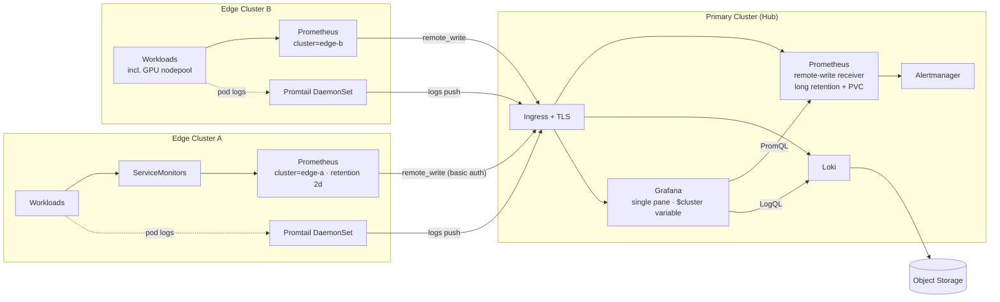

# Multi-Cluster Kubernetes Observability

Centralised metrics and logs for any number of Kubernetes clusters, viewed through a single Grafana.

One cluster acts as the **hub**, running Grafana, Prometheus, Loki and Alertmanager. Every other cluster runs a lightweight **edge** stack — a local Prometheus that scrapes in-cluster and `remote_write`s to the hub, plus a Promtail DaemonSet that ships pod logs to the hub's Loki. Edge clusters run no Grafana and keep only a short local retention buffer.

---

## Architecture



Every series and log line carries a `cluster` label, so dashboards get a cluster dropdown for free. Adding a cluster means deploying two Helm releases and nothing else.

---

## Repository layout

```
primary-cluster/
├── prometheus-values.yaml    # kube-prometheus-stack — remote-write receiver, Alertmanager
├── loki-values.yaml          # Loki SimpleScalable + object storage + ingestion limits
└── grafana-values.yaml       # standalone Grafana + dashboard sidecar

secondary-cluster/
├── prometheus-secondary-values.yaml   # scrapes locally, remote-writes to the hub
└── promtail-secondary-values.yaml     # ships pod logs to the hub's Loki
```

---

## Prerequisites

- Two or more clusters with `kubectl` contexts configured, Helm 3
- Ingress controller + cert-manager on the primary
- Object storage bucket/container for Loki chunks
- DNS records for the hub endpoints

```bash
helm repo add prometheus-community https://prometheus-community.github.io/helm-charts
helm repo add grafana https://grafana.github.io/helm-charts
helm repo update
```

---

## Install — primary cluster

```bash
kubectl config use-context <primary>
kubectl create namespace monitoring
```

Storage credentials for Loki go in a Secret, not in the values file:

```bash
kubectl create secret generic loki-storage-secret \
  --from-literal=access_key='<key>' \
  --from-literal=secret_key='<secret>' \
  -n monitoring
```

```bash
helm upgrade --install kube-prometheus-stack \
  prometheus-community/kube-prometheus-stack \
  -f primary-cluster/prometheus-values.yaml -n monitoring

helm upgrade --install loki grafana/loki \
  -f primary-cluster/loki-values.yaml -n monitoring

helm upgrade --install grafana grafana/grafana \
  -f primary-cluster/grafana-values.yaml -n monitoring
```

Then expose `grafana`, `kube-prometheus-stack-prometheus` and `loki-gateway` through an Ingress with TLS. Put basic auth in front of the Prometheus host — it accepts writes from the public internet.

Confirm Loki is reachable:

```bash
curl https://loki.example.com/loki/api/v1/labels
```

> `loki-gateway` does not proxy `/ready`. A 404 there is expected and does not mean Loki is down.

---

## Install — each edge cluster

Create the remote-write secret **before** the Helm release. The Prometheus Operator refuses to render a config while the referenced secret is missing and will loop on `sync failed`.

```bash
kubectl config use-context <edge>
kubectl create namespace monitoring

kubectl create secret generic remote-write-auth \
  --from-literal=user='<username>' \
  --from-literal=password='<password>' \
  -n monitoring
```

Set a unique `externalLabels.cluster` and the hub URLs in both values files, then:

```bash
helm upgrade --install kube-prometheus-stack \
  prometheus-community/kube-prometheus-stack \
  -f secondary-cluster/prometheus-secondary-values.yaml -n monitoring

helm upgrade --install promtail grafana/promtail \
  -f secondary-cluster/promtail-secondary-values.yaml -n monitoring
```

---

## Application metrics

Prometheus discovers app metrics through `ServiceMonitor` objects:

```yaml
apiVersion: monitoring.coreos.com/v1
kind: ServiceMonitor
metadata:
  name: my-app-monitor
  namespace: monitoring
  labels:
    release: kube-prometheus-stack
spec:
  namespaceSelector:
    matchNames: [my-app-namespace]
  selector:
    matchLabels:
      app: my-app        # matches the Service's labels, not the Pod's
  endpoints:
    - port: http         # the Service port's name, not its number
      path: /metrics
```

Those two lines account for most "target never appears" cases. Check both before debugging anything else:

```bash
kubectl get svc -n <namespace> --show-labels
```

---

## Dashboards

`kube-prometheus-stack` ships the `kubernetes-mixin` dashboards. With Grafana installed separately, the stack still generates the ConfigMaps (`forceDeployDashboards`) and Grafana's sidecar collects them — both sides are already configured in the values files.

```bash
kubectl get configmap -n monitoring -l grafana_dashboard=1
```

**Keep:** Compute Resources (Cluster / Namespace / Node / Pod / Workload), Kubelet, Node Exporter, Networking, Persistent Volumes, Prometheus Overview.

**Delete on managed control planes (EKS/AKS/GKE):** etcd, kube-controller-manager, kube-scheduler — those metrics aren't exposed and the panels render empty. Also kube-proxy if the cluster uses Cilium.

> Dashboards from grafana.com under "Kubernetes Monitoring" or "integrations" are written for Grafana Cloud and filter on `job="integrations/kubernetes/kubelet"`. Self-hosted uses `job="kubelet"`, so every panel comes back empty. Use the `kubernetes-mixin` versions.

---

## Verification

In Grafana → Explore:

```promql
count by (cluster) (up)          # every cluster, no empty label
count by (cluster, job) (up)     # per-cluster target breakdown
```

```logql
sum by (cluster) (rate({cluster=~".+"}[5m]))
count by (namespace) (count_over_time({cluster="edge-a"}[6h]))
```

Remote-write health is a local metric on the edge and is not forwarded — port-forward the edge's Prometheus to see it:

```promql
prometheus_remote_storage_failed_samples_total   # should stay flat
prometheus_remote_storage_pending_samples        # should not accumulate
```

---

## Troubleshooting

| Symptom | Cause | Fix |
|---|---|---|
| Operator loops `secret "remote-write-auth" not found` | Secret created after the release | Create it; the operator reconciles on its own |
| `401` on remote write | Secret key names don't match the values file | Keys must be `user` and `password` |
| `404` on `/api/v1/write` | Receiver not enabled on the hub | `enableRemoteWriteReceiver: true` |
| `429 ingestion rate limit exceeded` | Loki defaults too low for multi-cluster | Raise `ingestion_rate_mb`; lower Promtail `batchsize` |
| `400 timestamp too old` | Promtail replaying long-lived pods' log history | Expected on first install; it drains. Raise `reject_old_samples_max_age` to keep the backlog |
| Only `kube-system` and `monitoring` targets appear | Selector defaults restricting discovery | `serviceMonitorSelectorNilUsesHelmValues: false` with empty selectors |
| One nodepool's logs missing | Promtail not scheduled on tainted nodes | Blanket tolerations; check `kubectl get pods -o wide` |
| ServiceMonitor exists but no target | Service label or port name mismatch | See Application metrics above |
| `servicemonitors.azmonitoring.coreos.com not found` | Managed monitoring addon registers a colliding CRD | Qualify the group: `servicemonitors.monitoring.coreos.com` |
| Blank entry in the cluster dropdown | Hub Prometheus missing `externalLabels` | Add `cluster` to the primary's `prometheusSpec` |

---

## Design notes

**One `cluster` value per actual cluster.** Nodepools are distinguished by the `node` label, which the mixin dashboards already handle. Giving a GPU nodepool its own `cluster` value fragments roll-ups.

**Scrape locally, push centrally.** An edge workload should be scraped by its own cluster's Prometheus over ClusterIP. Exposing a metrics port publicly so the hub can scrape it directly works, but it's unnecessary attack surface.

**Explicit labels beat `externalLabels`.** A label set in a `static_configs` block wins permanently — a static target with a hardcoded `cluster` keeps it forever.

**Keep edge retention short.** The hub is the system of record; edge storage only buffers the gap between scrape and successful push.

**Alert on the hub.** Edge Alertmanagers mean duplicate notifications and per-cluster silence lists.